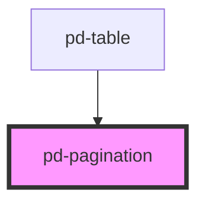

# pd-pagination

## Usage

```html
<pd-pagination total-pages="10" current-page="3" visible-pages="5"></pd-pagination>
```

`pd-pagination` is controlled: `pd-change` emits the requested one-based page number,
but does not update `currentPage`. The parent fetches or selects the corresponding
data and updates `currentPage`:

```js
const pagination = document.querySelector('pd-pagination');
pagination.addEventListener('pd-change', event => {
    pagination.currentPage = event.detail;
});
```

By default, the component displays the current page, the separator (`von`), and the
total page count. Set `show-page-buttons` to display up to `visiblePages` numbered
buttons instead. First, previous, next, and last buttons are available in both modes.
Changing `currentPage`, `totalPages`, or `visiblePages` updates the visible page range.

Use integer values for page numbers and non-negative integers for `totalPages` and
`visiblePages`. An out-of-range `currentPage` is clamped for display and navigation
without changing the supplied prop. With zero pages, the summary displays `0 von 0`,
there are no numbered buttons, and all navigation buttons are disabled.

The component provides a navigation landmark, German accessible button labels,
`aria-current="page"` for the selected numbered button, and a live summary in simple
mode. All buttons use `type="button"` and support native keyboard activation.
The host's `aria-label` can distinguish multiple pagination landmarks.

## Table integration

`pd-table` already uses this component for its built-in paging. It remains responsible
for selecting rows and page sizes; `pd-pagination` only requests page changes.

For server-side paging, set `external-row-handling` on the table and place a
`pd-pagination` in its `external-pagination` slot. The parent handles `pd-change`,
fetches the data, and updates the table's `rows` and the pagination's `currentPage`
and `totalPages`.

<!-- Auto Generated Below -->


## Overview

Controlled page navigation. Handle pd-change and update currentPage in the parent.

## Properties

| Property          | Attribute           | Description                                                           | Type      | Default |
| ----------------- | ------------------- | --------------------------------------------------------------------- | --------- | ------- |
| `currentPage`     | `current-page`      | Current page number (one-based).                                      | `number`  | `1`     |
| `separator`       | `separator`         | Separator string in simple mode.                                      | `string`  | `'von'` |
| `showPageButtons` | `show-page-buttons` | Show numbered page buttons instead of the current/total page summary. | `boolean` | `false` |
| `totalPages`      | `total-pages`       | Number of pages. Use zero for an empty result.                        | `number`  | `5`     |
| `visiblePages`    | `visible-pages`     | Maximum number of visible page buttons in showPageButtons mode.       | `number`  | `5`     |


## Events

| Event       | Description                                                                  | Type                  |
| ----------- | ---------------------------------------------------------------------------- | --------------------- |
| `pd-change` | Page change request. Returns the selected page without changing currentPage. | `CustomEvent<number>` |


## Dependencies

### Used by

 - [pd-table](../pd-table)

### Graph


----------------------------------------------

*Built with [StencilJS](https://stenciljs.com/)*
